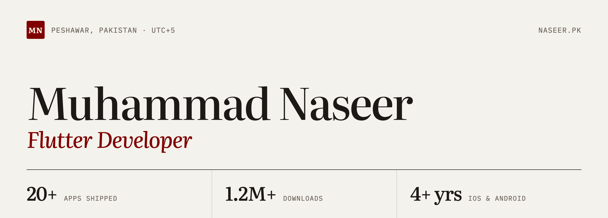
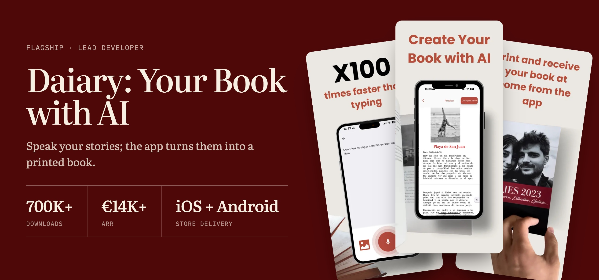
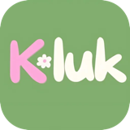

<a href="https://www.naseer.pk/">
  <picture>
    <source media="(prefers-color-scheme: dark)" srcset="assets/banner-dark.png">
    
  </picture>
</a>

I build iOS and Android apps with Flutter, from the first screen to the store release. Over 4+ years I've shipped 20+ apps for startups and consumer products, with 1.2M+ downloads between them. I run [OpenTech](https://www.opentech.com.pk/) and take on freelance app projects remotely.

[Portfolio](https://www.naseer.pk/) &nbsp;·&nbsp; [Hire me](https://www.naseer.pk/hire-flutter-developer/) &nbsp;·&nbsp; [Resume](https://www.naseer.pk/Muhammad%20Naseer.pdf) &nbsp;·&nbsp; [LinkedIn](https://www.linkedin.com/in/naseerx/) &nbsp;·&nbsp; [X](https://x.com/its_naseerx) &nbsp;·&nbsp; [Instagram](https://www.instagram.com/its_naseerz/) &nbsp;·&nbsp; [Email](mailto:muhammadnaseer.dev@gmail.com)

## Flagship

**Daiary** turns voice notes into a print-ready book: AI transcribes what you say, lays it out, and a printed copy ships to your door. I built it from the ground up as lead developer, with offline-first Firebase sync and push notifications.

[Read the case study](https://www.naseer.pk/projects/daiary/) &nbsp;·&nbsp; [App Store](https://apps.apple.com/us/app/daiary-book/id6475233413) &nbsp;·&nbsp; [Google Play](https://play.google.com/store/apps/details?id=com.victor.dairy)

## Selected work

<table>
  <tr>
    <td width="76"></td>
    <td><b>Kluk</b> &nbsp;AI WARDROBE Style-aware clothing management with AI assistance.</td>
    <td width="190"><a href="https://apps.apple.com/us/app/kluk-your-clothes-with-ai/id6752724286">App Store</a> &nbsp;·&nbsp; <a href="https://play.google.com/store/apps/details?id=com.victor.cluq">Google Play</a></td>
  </tr>
  <tr>
    <td></td>
    <td><b>Mint AI</b> &nbsp;AI MEDITATION Guided meditations generated as audio, tailored to how you feel.</td>
    <td><a href="https://apps.apple.com/us/app/mint-ai/id6745750368">App Store</a> &nbsp;·&nbsp; <a href="https://play.google.com/store/apps/details?id=com.victor.mint">Google Play</a></td>
  </tr>
  <tr>
    <td></td>
    <td><b>BukBuk</b> &nbsp;AUDIO + AI Turns ideas into audiobook-style listening.</td>
    <td><a href="https://apps.apple.com/us/app/bukbuk-ideas-to-audiobooks/id6745130037">App Store</a> &nbsp;·&nbsp; <a href="https://play.google.com/store/apps/details?id=com.victor.bukbuk">Google Play</a></td>
  </tr>
  <tr>
    <td></td>
    <td><b>Sapere</b> &nbsp;MICRO-LEARNING Bite-sized lessons you can finish in minutes.</td>
    <td><a href="https://apps.apple.com/us/app/sapere-learn-in-minutes/id6746458440">App Store</a> &nbsp;·&nbsp; <a href="https://play.google.com/store/apps/details?id=com.victor.sapere">Google Play</a></td>
  </tr>
  <tr>
    <td></td>
    <td><b>Pinelift</b> &nbsp;TRANSPORT Ride-sharing built around maps and dependable booking.</td>
    <td><a href="https://apps.apple.com/us/app/pinelift/id6749968372">App Store</a> &nbsp;·&nbsp; <a href="https://play.google.com/store/apps/details?id=pinelift.felidaen.co">Google Play</a></td>
  </tr>
  <tr>
    <td></td>
    <td><b>Radiant Notes</b> &nbsp;MEDICAL EDUCATION Book reader, quizzes and AI study features for medical students.</td>
    <td></td>
  </tr>
</table>

## Also shipped

| App | What it is |
|-----|------------|
| **Zuka** | Ride-sharing for riders and drivers · [App Store](https://apps.apple.com/us/app/zuka-driver/id6752115744) · [Google Play](https://play.google.com/store/apps/details?id=com.zukalift.customer) |
| **Drop** | Member discounts and rewards · [App Store](https://apps.apple.com/us/app/drop-member-discount-reward/id6742413272) |
| **Islam2Go** | Islamic lifestyle app for Switzerland: halal food, mosques, prayer times and Qibla |
| **LocalLoop** | Location-based community platform with reviews and local interactions |
| **Joygram** | Character-based AI video generator for kids' special moments |
| **Echoes** | Saves memories as audio instead of written journal entries |
| **Meetly** | Local events discovery with real-time chat |
| **Gathro** | Event planning and group gathering organiser |
| **FixPro** | On-demand home services and repair booking |
| **HRMS** | Employee tracking and payroll for HR teams |

## Toolkit

| | |
|---|---|
| **Mobile** | Flutter · Dart · BLoC · Provider · GetX · Clean Architecture |
| **Backend** | Firebase · Firestore · Cloud Functions · REST APIs |
| **Delivery** | App Store and Play Store releases · Fastlane · Git · Figma |

## On GitHub

Most client work lives in private repositories. Two public examples: [Flutter-Todo-App](https://github.com/naseerx/Flutter-Todo-App), a todo app using Provider for state management, and [sqf_lite_flutter](https://github.com/naseerx/sqf_lite_flutter), a CRUD app showing local persistence with SQFlite.

## Work with me

I take on freelance builds, long-term contracts and product partnerships, hourly or fixed-price, and reply within 24 hours. [How hiring me works](https://www.naseer.pk/hire-flutter-developer/), or write to [muhammadnaseer.dev@gmail.com](mailto:muhammadnaseer.dev@gmail.com).
